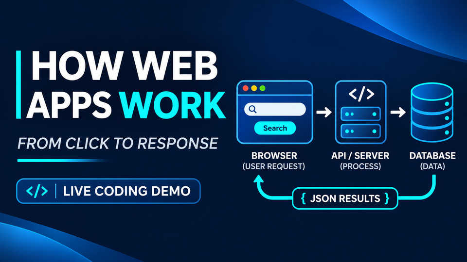

# Web Development Lessons Learned

**RequestScope — Trace a Search from Browser to Server and Back**

An individual web-development portfolio project exploring how an interface, a JavaScript client, and an Express API work together. A fictional vulnerability search demonstrates the HTTP request–response cycle, input validation, JSON responses, and updates to the Document Object Model (DOM).

The application uses a small **in-memory dataset** rather than a live vulnerability feed or database. Its navy-and-blue interface draws on the design of [VulnScope](https://github.com/jaiselbuilds/vulnscope), a separate full-stack cybersecurity project.

- **Repository:** [jaiselbuilds/web-dev-lessons-learned](https://github.com/jaiselbuilds/web-dev-lessons-learned)
- **Video walkthrough:** [How Web Applications Work — full narrated presentation](https://youtu.be/LiD-fVj6Lyc)
- **Live-coding chapter:** [Watch the Express and Fetch API demonstration](https://youtu.be/LiD-fVj6Lyc?t=1201) (starts at approximately 20:01)
- **Video post advertise (Bluesky):** [See Video Post](https://bsky.app/profile/jpaintsil.bsky.social/post/3mzb7fw53hs25)

## Presentation and Video Demo

[](https://youtu.be/LiD-fVj6Lyc)

**[Watch the full presentation on YouTube](https://youtu.be/LiD-fVj6Lyc)** (25:52). The narrated presentation explains HTML, CSS, JavaScript, the DOM, HTTP, Node.js, Express, MongoDB concepts, and full-stack architecture. It concludes with a **real VS Code and Chrome DevTools demonstration** using this repository's application.

*The presentation discusses MongoDB as a full-stack concept; the standalone coding example in this repository deliberately uses fictional records held in memory.*

## Author

### John Paintsil

- GitHub: [@jaiselbuilds](https://github.com/jaiselbuilds)
- Focus: client–server communication, web APIs, JavaScript, and accessible browser interactions.

## Project Objective

Make the request–response lifecycle tangible through a single search action:

1. Select a severity level and submit the form.
2. JavaScript sends `GET /api/vulnerabilities?severity=HIGH` with `fetch()`.
3. Express reads and validates the requested severity.
4. The server filters four fictional records and returns a status code and JSON.
5. JavaScript interprets the response and updates the page without a full reload.

The repository contains the **completed, working version** of the two coding tasks shown in the video: the Express route and the frontend Fetch API call. The folder retains its original `starter/` name so it can be followed alongside the recording.

## Pages

### Vulnerability Search — [`starter/public/index.html`](starter/public/index.html)

The single-page interface includes a VulnScope-inspired header, responsive layout, labeled severity selector, **Apply Filters** button, results panel, accessible status messages, and an explanation of the browser → API → JSON → DOM flow.

## JavaScript Functionality

- **Browser:** Intercepts form submission, builds the query URL, calls `fetch()`, parses JSON, checks `response.ok`, and safely renders results with `textContent`.
- **Server:** Uses an Express `GET` route to validate the query, filter sample records, and respond with JSON and appropriate HTTP status codes.
- **Error and empty states:** Distinguishes a successful search with zero matches from a rejected invalid request.

## Technologies

- Semantic HTML5 and responsive CSS3 (Flexbox and Grid)
- Vanilla JavaScript, ES modules, `async/await`, and the Fetch API
- Node.js 20+ and Express 5
- HTTP methods, query parameters, status codes, and JSON
- Chrome DevTools, Git, and GitHub

No MongoDB installation, API key, account, or external dataset is required to run this example.

## Project Structure

```text
web-dev-lessons-learned/
├── assets/
│   └── how-web-apps-work-thumbnail.jpg   
├── starter/
│   ├── app.js                             
│   ├── data.js                            
│   ├── server.js                          
│   ├── package.json
│   ├── package-lock.json
│   └── public/
│       ├── index.html                     
│       ├── styles.css                     
│       └── app.js                         
├── LICENSE
└── README.md
```

## Installation and Local Development

**Prerequisites:** Node.js 20 or later and npm.

```bash
# Clone the published repository.
git clone https://github.com/jaiselbuilds/web-dev-lessons-learned.git
cd web-dev-lessons-learned/starter

# Install dependencies and start Express.
npm ci
npm start
```

Open **http://localhost:3000** and select a severity level. During development, `npm run dev` starts Node.js in watch mode.

## Using the Application

Choose **HIGH**, then **Apply Filters**, to display two fictional records. Try **CRITICAL** to see an empty but successful result. Open Chrome DevTools → **Network → Fetch/XHR** to inspect the request URL, response status, and JSON body.

For the validation case, visit `http://localhost:3000/api/vulnerabilities?severity=INVALID` directly in the browser.

## API Endpoint

**`GET /api/vulnerabilities?severity=HIGH`**

| Query | HTTP response | Expected behavior |
| --- | --- | --- |
| `severity=HIGH` | `200 OK` | Two matching fictional records |
| `severity=ALL` | `200 OK` | All four sample records |
| `severity=CRITICAL` | `200 OK` | Empty results array (`count: 0`) |
| `severity=INVALID` | `400 Bad Request` | JSON validation error |

Successful responses use the shape `{ "count": number, "results": [...] }`. The supported severity values are `ALL`, `LOW`, `MEDIUM`, `HIGH`, and `CRITICAL` (uppercase).

## Code Quality and Validation

The application separates server startup from Express route configuration and uses short inline comments. Browser data is inserted as text rather than HTML. The demonstration verifies matching results, an empty successful response, and an invalid-request error. This repository does not claim an automated test suite or formal security certification.

## Accessibility

The page includes semantic form controls, a labeled severity selector, keyboard focus treatment, a skip link, and a live results-status region. These features are design considerations, not a formal accessibility compliance claim.

## Design and References

The search workspace takes design cues from [VulnScope](https://github.com/jaiselbuilds/vulnscope); its scope and data remain independent. The video thumbnail is included in [`assets/`](assets/how-web-apps-work-thumbnail.jpg) so the README preview stays with the repository.

Technical references:

- [MDN — Using the Fetch API](https://developer.mozilla.org/en-US/docs/Web/API/Fetch_API/Using_Fetch)
- [Express — Routing](https://expressjs.com/en/guide/routing.html)
- [MDN — Document Object Model](https://developer.mozilla.org/en-US/docs/Web/API/Document_Object_Model)

## License

Licensed under the [MIT License](LICENSE).
